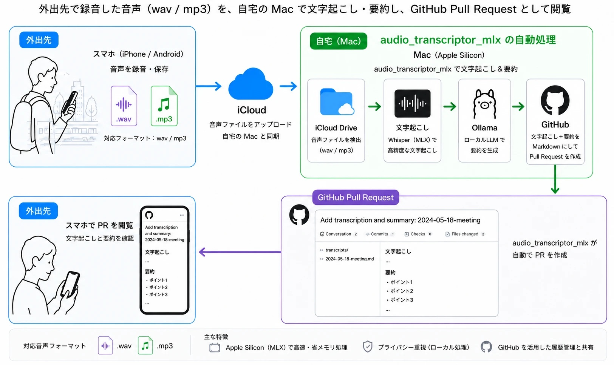
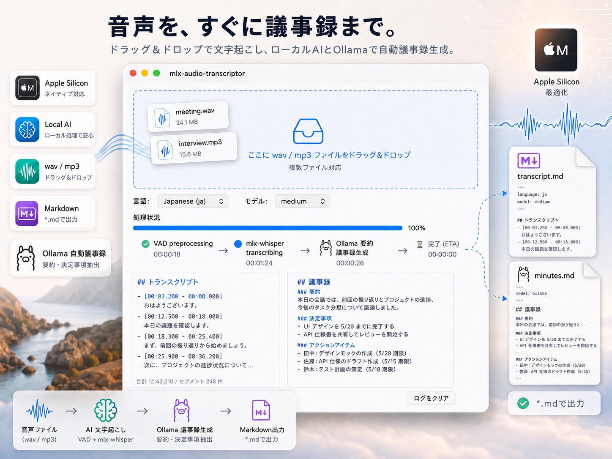

# audio_transcriptor_mlx



macOS Apple Silicon 上で動作する、ローカル音声文字起こしツール。  
`wav` / `mp3` を `mlx-whisper` で文字起こしし、同フォルダに Markdown ファイルを保存する。文字起こしから議事録生成まで、すべてローカルで完結する。

監視フォルダに音声を置くだけで処理が走る**自動モード**と、ファイルをその都度処理する **GUI モード**がある。主な使い方は前者。

## 主な使い方: iCloud フォルダの自動監視

外出先で録音した音声を iCloud Drive に入れておくと、自宅の Mac が自動で取得して文字起こし・議事録生成し、指定した Git リポジトリへ Pull Request を作成する（冒頭の図）。出先ではその PR を開いて文字起こしと議事録を読む。

図の Mac 上の 4 段階は、次の機能に対応する。

| 図の段階 | 使う機能 | 設定 |
|---|---|---|
| iCloud Drive の音声ファイルを検出 | [監視フォルダの自動処理](#使い方-b-監視フォルダの自動処理launchd) | `watch_dir` を iCloud Drive 配下に設定 |
| Whisper（MLX）で文字起こし | 本体の文字起こし | `model` / `language` |
| Ollama のローカル LLM で要約を生成 | [議事録生成（Ollama 連携）](#議事録生成ollama-連携) | `[minutes].enabled = true`（既定） |
| Markdown にして Pull Request を作成 | [任意 Git リポジトリへの自動 PR](#任意-git-リポジトリへの自動-pr-auto_pr) | `[auto_pr].enabled = true`（既定 off） |

> **元の音源は既定でゴミ箱へ移動される**（自動 PR が無効、または PR 作成に成功した場合）。iCloud Drive を監視フォルダにする場合、削除は同期されて iPhone 側からも消える。音源を残したい場合は `config.toml` で `trash_source_after_success = false` を設定する。

## 動作環境

- macOS（Apple Silicon 必須）
- Python 3.11 以上
- 仮想環境推奨
- `ffmpeg`（mlx-whisper が音声デコードに使用）

## 2 つの使い方

このツールは 2 通りの使い方ができる。用途で選択する。

| 使い方 | 向いている場面 | 操作 |
|--------|---------------|------|
| **B. 監視フォルダの自動処理**（主） | iCloud Drive や AirDrop で送った音声を放置で処理したい | LaunchAgent をインストール（初回のみ）。以降は監視フォルダに置くだけ |
| **A. GUI アプリで手動文字起こし** | 任意のファイルをその都度処理したい | アプリを起動して `wav` / `mp3` をドラッグ&ドロップ |

両方を併用してもよい。設定ファイル（`~/.config/mlx-audio-transcriptor/config.toml`）は GUI と CLI で共通で、議事録生成（Ollama 連携）も共通で動く。

## 事前準備

### ffmpeg

`mlx-whisper` は音声ファイルのデコードに `ffmpeg` を使用するため、システムに `ffmpeg` をインストールしておく必要がある。`.mp3` を扱う場合は必須。

```bash
brew install ffmpeg
```

インストール確認:

```bash
ffmpeg -version
```

### Ollama（議事録生成を使う場合）

文字起こし完了後、ローカルの Ollama を呼んで議事録 Markdown を自動生成する機能を既定で有効にしている。
Ollama 未インストールでも文字起こし自体は完走するが、議事録生成だけが毎回失敗する。
不要なら `~/.config/mlx-audio-transcriptor/config.toml` の `[minutes].enabled = false` で無効化できる。

```bash
brew install ollama
ollama serve &           # 別タブで起動しっぱなしにする
ollama pull gemma4       # 既定モデル。config.toml の [minutes].model と一致させる
```

`ollama list` で取得済みモデルを確認できる。

## インストール

```bash
python -m venv .venv
source .venv/bin/activate
pip install -r requirements.txt
```

## 使い方 A: GUI アプリで手動文字起こし



### 起動

```bash
python -m app.main
```

### 操作手順

1. 言語（`Japanese` / `English` / `Auto (ja/en mixed)`）とモデルを選択する
2. `wav` または `mp3` ファイルをウィンドウにドラッグ&ドロップする
3. プログレスバーと経過時間／ETA がリアルタイムで更新される
4. 完了すると、入力ファイルと同じフォルダに `*.transcript.md` が生成される。
   `[minutes].enabled = true`（既定）かつ Ollama が動作していれば、続けて `<YYYY-MM-DD>_<英語スラッグ>.md` という議事録ファイルも同じフォルダに生成される

複数ファイルを同時にドロップ可。逐次処理。

## 使い方 B: 監視フォルダの自動処理（launchd）

監視フォルダに音声が入ったら、GUI を開かずに自動で文字起こしし、元ファイルをゴミ箱へ送るバックグラウンドモード。監視先は `watch_dir` で指定する（既定 `~/Downloads`）。

### セットアップ（初回のみ）

```bash
./scripts/install-watcher.sh          # 登録（初回は config.toml を自動配置）
./scripts/uninstall-watcher.sh        # 解除
```

### 監視フォルダを iCloud Drive にする

監視先のフォルダを先に作る（`install-watcher.sh` は作成しない。フォルダが無いと警告を出して何も処理しない）。

```bash
mkdir -p ~/Library/Mobile\ Documents/com~apple~CloudDocs/Recordings
```

`~/.config/mlx-audio-transcriptor/config.toml` の `watch_dir` を書き換える。

```toml
watch_dir = "~/Library/Mobile Documents/com~apple~CloudDocs/Recordings"
trash_source_after_success = false    # iCloud 上の音源を残したい場合
```

**変更後は `./scripts/install-watcher.sh` を再実行する。** launchd が監視するパスはインストール時に書き込まれるため、再実行しないと以前のフォルダを監視し続ける。

iCloud 特有の注意:

- **元音源の削除は同期される。** 既定の `trash_source_after_success = true` のままだと、処理後に iCloud 上の音源がゴミ箱へ移動し、iPhone 側からも消える。残したい場合は `false` にする
- **ローカルに保持しておく。** 本ツールは iCloud のダウンロード状態を検出せず、ファイルサイズと更新時刻が安定したかどうかだけを見る。監視フォルダは Finder で「このMacにダウンロードを保持」を選ぶ。クラウドアイコンが残っている場合は、ダウンロード完了後に置き直す
- **監視するのは `watch_dir` の直下のみ。** サブフォルダは見ない

### 使い方

1. 監視フォルダに `.wav` / `.mp3` を保存する（iCloud Drive / AirDrop / コピーなど）
2. 数十秒待つと同フォルダに `*.transcript.md`（および議事録 `.md`）が生成される
3. 元の音源は自動でゴミ箱へ移動される（`trash_source_after_success = false` で無効化可）
4. 処理開始 / 25%・50%・75% 進捗 / 完了は macOS 通知センターへ届く

さらに [`[auto_pr]`](#任意-git-リポジトリへの自動-pr-auto_pr) を有効にすると、文字起こしと議事録を Git リポジトリへ自動 PR できる（冒頭の図の流れ）。

### 詳細

フルディスクアクセス権限の付与、ログの確認、トラブルシュートなどは [`docs/mac-watcher-setup.md`](docs/mac-watcher-setup.md) を参照。設定ファイル `~/.config/mlx-audio-transcriptor/config.toml` は GUI の既定言語／モデル選択にも反映される。

## 処理の流れ

1. **VAD 前処理（任意）** — `[vad].enabled = true` のとき、silero-vad で無音区間を除去し、発話区間のみ連結した PCM を生成する
2. **文字起こし** — mlx-whisper（Apple Silicon MLX）に渡して書き起こす
3. **タイムスタンプ再マッピング（VAD 有効時のみ）** — VAD で圧縮した時間軸を元ファイルのタイムラインに戻す
4. **Markdown 保存** — 同フォルダに `*.transcript.md` として出力する
5. **議事録生成（任意）** — `[minutes].enabled = true` のとき、トランスクリプトを Ollama (`/api/generate`) に投げて議事録 Markdown を生成する。失敗してもトランスクリプト本体は保持され、ゴミ箱送りも実行される（best-effort）

> VAD は既定で無効。小さい声や遠い話者を無音と判定し、数十分単位で発話を捨てることがあったため。有効にする場合は `config.toml` で設定する（UI からは切り替え不可）。無効だと長い無音区間で Whisper が定型句（「ご視聴ありがとうございました」など）を幻覚しやすくなる。不正な値・範囲外の値は警告ログを出して既定値に戻る。

```toml
[vad]
enabled = false        # true で VAD 前処理を有効化
threshold = 0.5        # 発話と判定する確率のしきい値。下げるほど小さい声を拾う
min_silence_ms = 500   # この長さ以上の無音で区間を区切る
speech_pad_ms = 200    # 各発話区間の前後に足す余白
```

## 出力フォーマット

```markdown
---
language: ja
model: medium
---

## Transcript

- [00:03.200 - 00:08.000] おはようございます。
- [01:02:03.456 - 01:02:08.000] 1時間を超える場合は HH:MM:SS.mmm 形式
```

タイムスタンプは `MM:SS.mmm`、1時間超は `HH:MM:SS.mmm`。  
同名ファイルが存在する場合は `meeting.transcript.1.md` のように連番が付く。

## 議事録生成（Ollama 連携）

`[minutes].enabled = true`（既定）のとき、トランスクリプト書き出し直後にローカルの Ollama を呼び出して議事録 Markdown を生成する。GUI・CLI どちらの経路でも動く。

### 出力ファイル

- ファイル名: `<音声ファイルの更新日時 YYYY-MM-DD>_<英語スラッグ>.md`（例: `2026-05-08_budget_meeting.md`）。本文は日本語のまま、ファイル名だけは必ず半角英数字（LLM が生成する英語スラッグ）になる
- 出力先: トランスクリプトと同じディレクトリ
- 同名ファイルが存在する場合は `2026-05-08_budget_meeting.1.md` のように連番が付く

フロントマター例:

```markdown
---
date: 2026-05-08
source_audio: meeting.wav
transcript: meeting.transcript.md
language: ja
whisper_model: medium
ollama_model: gemma4
topic: 予算会議
---

（Ollama が生成した本文）

---
原文書き起こし: [meeting.transcript.md](meeting.transcript.md)
```

### 設定（`config.toml` の `[minutes]` テーブル）

```toml
[minutes]
enabled = true                      # false で機能全体を無効化
ollama_host = "http://localhost:11434"
model = "gemma4"                    # ollama pull で取得したモデル名
prompt_language = "ja"              # "ja" / "en" — 出力の見出し言語
num_ctx = 32768                     # コンテキスト長。8GB Mac → 16384、16GB → 32768、32GB+ → 65536
max_input_chars = 30000             # 送信する書き起こしの最大文字数
request_timeout_seconds = 600.0    # num_ctx >= 32768 なら 600 以上推奨
```

詳細なコメント付き設定例は [`config.toml.example`](config.toml.example) の `[minutes]` セクションを参照。

### 失敗時の挙動

Ollama 未起動・モデル未取得・タイムアウト等で失敗しても、トランスクリプト本体および `trash_source_after_success` による元ファイルのゴミ箱送りには影響しない（best-effort）。
CLI では macOS 通知センターに「議事録生成失敗」が届き、GUI ではログペインに記録される。

## 任意 Git リポジトリへの自動 PR (`[auto_pr]`)

`[auto_pr].enabled = true` のとき、文字起こし（および議事録）書き出し直後に、指定したローカルクローンの Git リポジトリへ自動でブランチを作成 → コミット → push → `gh pr create` で PR を作成する。launchd watcher 経由の自動運用に組み込む想定。GUI 経路には組み込んでいない。

### 動作

1. `origin/<default_branch>` を fetch する
2. 一時 `git worktree` を `origin/<default_branch>` から作成する（通常のローカルクローンには触れない）
3. 一時 worktree 内で `<branch_prefix><YYYY-MM-DD>-<6文字ランダム英数字>` のブランチを切る
4. `transcript_subdir` / `minutes_subdir` にトランスクリプトと議事録をコピーしてコミット
5. push して `gh pr create`
6. 一時 worktree を削除する

### PR を作らず main へ直接コミットする（`mode = "direct"`）

`mode = "direct"` にすると、上の 3・5 を行わず、`origin/<default_branch>` の上にコミットして `HEAD:<default_branch>` へ直接 push する（`gh` は不要）。他の push と競合して拒否された場合は fetch → rebase して最大 3 回まで再試行する（認証エラーや保護ブランチなど、それ以外の拒否は再試行しない）。force push はしない。レビューを経ずに全文が main に入る点と、保護ブランチでは必ず失敗する点に注意。rebase が衝突した場合や再試行を使い切った場合は失敗扱い（`PR 作成失敗` と同じ扱いで元音声は残る）。通知のタイトルは `コミット中…` / `コミット完了` / `コミット失敗` になる。

### 警告（公開リポジトリ運用上の注意）

- この機能は **トランスクリプト全文を push 先リポジトリにコミットする**。録音内容に機微情報を含む可能性がある場合、push 先は **private リポジトリに限定** すること。
- 認証は実行ユーザーの `gh` CLI 認証情報に依存する（`gh auth status` で確認）。共有マシンでの利用は避ける。
- ローカルクローンを事前に `git clone` し、`gh` でも操作できる状態にしておくこと。

### 設定（`config.toml` の `[auto_pr]` テーブル）

詳細なコメント付き設定例は [`config.toml.example`](config.toml.example) の `[auto_pr]` セクションを参照。

```toml
[auto_pr]
enabled = false                            # 既定 off
repo_path = "~/path/to/your-repo"          # ローカルクローンパス
transcript_subdir = ""                     # 配置先（空ならリポジトリルート直下）
minutes_subdir = ""
default_branch = "main"
branch_prefix = "auto-transcript/"
commit_message_template = "add transcript for {date}"
pr_title_template       = "add transcript for {date}"
pr_body_template = "..."                   # テンプレート変数: {date}, {transcript_name}, {minutes_name}, {topic}, {branch}
gh_repo = ""                               # 空なら origin remote から自動推定
mode = "pr"                                # "pr" または "direct"（default_branch へ直接 push）
```

### 通知

議事録生成と同じく **3 段階** で macOS 通知センターに届く:

| タイミング | タイトル | 本文 |
|---|---|---|
| ブランチ作成前 | `PR 作成中…` | `→ <repo名>` |
| `gh pr create` 成功直後 | `PR 作成完了` | PR の URL |
| 任意ステップで失敗 | `PR 作成失敗` | 失敗理由（先頭 200 文字） |

`repo_path` 不在や `git` / `gh` が見つからない場合など、ブランチを作る前段の preflight で abort した場合は「PR 作成中…」を出さず、失敗通知のみが届く。

`mode = "direct"` のときはタイトルが `コミット中…` / `コミット完了`（本文は `<repo名>@<branch>: <コミットメッセージ>`）/ `コミット失敗` になり、preflight で `gh` は確認しない。

### 失敗時の挙動

PR 作成中の任意のステップで失敗した場合、トランスクリプト本体は保持されるが、`trash_source_after_success` による元音声のゴミ箱送りは **スキップ** される（後から手動 push できるよう元ファイルを残す）。

## 対応ファイル

| 拡張子 | 備考 |
|--------|------|
| `.wav` | 大文字小文字不問 |
| `.mp3` | 大文字小文字不問 |

## モデル

| モデル | 備考 |
|--------|------|
| `tiny` | 最速・低精度 |
| `base` | |
| `small` | |
| `medium` | デフォルト |
| `large-v3` | 最高精度 |
| `large-v3-turbo` | large-v3 に近い精度で高速。`mixed` 言語モードの推奨 |

初回使用時はモデルが自動ダウンロードされる。

## 日英混在の会議（`language = "mixed"`）

`config.toml` の `language = "mixed"`（GUI では `Auto (ja/en mixed)`）にすると、発話の区切りごとに日本語／英語を自動判定して文字起こしする。

- 発話区間（VAD 無効時は 30 秒以下の窓）ごとに ja / en を判定する（候補は ja と en のみ。他の言語に誤判定されない）
- 0.5 秒未満の区間や判定があいまいな区間は、直前の区間の言語を引き継ぐ
- en と判定するには ja より厳しい確率差（`[mixed].en_min_margin`、既定 0.5。0.2 以上 1.0 未満）が要る。判定したが差が足りない区間は、1 位が ja なら直前が en でも ja にし、1 位が en なら直前の言語を引き継ぐ。日本語を英語と誤判定して中身を失うのを防ぐため
- en で起こした結果が 3 秒以上の区間で 1 秒あたり 3 文字未満（例: 28 秒で「Yeah.」）なら、ja で起こし直して長い方を採る。結果が空なら起こし直さない。起こし直しに失敗したら en の結果を残す
- 限界: 日本語を en で起こした結果が英訳として出た場合は文字数が多いため救えない（`en_min_margin` で誤判定自体を抑える前提）。VAD 無効時は無音を含む窓が疎と判定され、ja の起こし直しで幻覚した定型句に置き換わることがある
- 同じ言語が続く区間をまとめて、その言語で文字起こしする。30 秒を超える区間は、15〜30 秒の範囲で最も静かな点で分割する
- 1 文の中に英単語が混ざる程度の切り替えは、その区間の言語で書かれる
- 区間ごとに言語判定と文字起こしを行うため、`ja` / `en` 固定より処理時間が長い
- 英語専用モデル（`*.en` など）は使えない（エラーで止まる）
- 言語判定が失敗し続けた場合は判定を打ち切り、以降は直前の区間の言語で文字起こしする

```toml
language = "mixed"
model = "large-v3-turbo"
```

> VAD の音声読み込みを ffmpeg 経由に変更した。以前は 16kHz 以外（44.1/48kHz の一般的な録音）で VAD が黙って無効になっていた。修正後に VAD が実際に効いた結果、長い発話の欠落が起きたため、VAD は既定で無効にした。

## プロジェクト構成

```
mlx-audio-transcriptor/
├── app/
│   ├── main.py                        # GUI エントリーポイント
│   ├── cli.py                         # ヘッドレス CLI（launchd から呼ばれる）
│   ├── config.py                      # TOML 設定ロード（GUI/CLI 共用）
│   ├── ui/
│   │   ├── main_window.py             # メインウィンドウ（プログレスバー・ログペイン）
│   │   └── drop_area.py               # D&D ウィジェット
│   ├── services/
│   │   ├── transcriber.py             # mlx-whisper 呼び出し
│   │   ├── vad.py                     # silero-vad 前処理・タイムスタンプ再マッピング
│   │   ├── segment_merger.py          # 発話区間のマージ
│   │   ├── repetition.py              # Whisper の反復ループを [反復省略] に縮める
│   │   ├── hallucination.py           # 無音区間の定型句（幻聴）を判定
│   │   ├── mixed_language.py          # mixed モードの区間分割・言語確定・グループ化
│   │   ├── markdown_writer.py         # Markdown 生成・保存
│   │   ├── file_naming.py             # 連番ファイル名決定
│   │   ├── notifier.py                # macOS 通知センター連携（CLI のみ）
│   │   ├── progress.py                # 25/50/75% マイルストーン通知コールバック
│   │   ├── minutes.py                 # 議事録生成オーケストレーター（best-effort）
│   │   ├── minutes_generator.py       # Ollama HTTP クライアント（urllib.request）
│   │   ├── minutes_writer.py          # <日付>_<議題>.md ファイル生成・採番
│   │   └── auto_pr.py                 # 任意 Git リポジトリへの自動 PR（best-effort）
│   ├── workers/
│   │   └── transcription_worker.py    # バックグラウンド処理（進捗通知）
│   └── models/
│       └── types.py                   # Segment / TranscriptionResult
├── scripts/
│   ├── com.mlx-audio-transcriptor.watcher.plist.template
│   ├── install-watcher.sh             # LaunchAgent 設置
│   └── uninstall-watcher.sh
├── docs/
│   └── mac-watcher-setup.md           # 監視フォルダ自動処理のセットアップ手順
├── config.toml.example
└── tests/
    ├── test_file_naming.py
    ├── test_markdown_writer.py
    ├── test_vad.py
    ├── test_segment_merger.py
    ├── test_repetition.py
    ├── test_hallucination.py
    ├── test_mixed_language.py
    ├── test_transcriber_mixed.py
    ├── test_config.py
    ├── test_cli_scan.py
    ├── test_notifier.py
    ├── test_progress.py
    ├── test_minutes_generator.py
    ├── test_minutes_orchestrator.py
    ├── test_minutes_writer.py
    └── test_auto_pr.py
```

## テスト

```bash
pytest
```

## 依存パッケージ

- [PySide6](https://doc.qt.io/qtforpython/) — GUI
- [mlx-whisper](https://github.com/ml-explore/mlx-examples/tree/main/whisper) — 音声文字起こし（Apple Silicon MLX）
- [silero-vad](https://github.com/snakers4/silero-vad) — 無音区間検出（VAD 前処理）
- [soundfile](https://python-soundfile.readthedocs.io/) — 音声ファイル読み込み
- [Send2Trash](https://github.com/arsenetar/send2trash) — 自動監視モードで元ファイルをゴミ箱へ送る

**外部ランタイム（任意）**

- [Ollama](https://ollama.com/) — 議事録生成（Python パッケージ追加なし。stdlib `urllib.request` で疎通するため `requirements.txt` の変更は不要）

## 制限事項

- 話者分離・動画ファイルは非対応
- 自動言語判定は `mixed` モードの ja / en のみ
- キャンセル・一時停止機能なし
- `.app` 化非対応
- 議事録生成は best-effort で、Ollama 未起動・モデル未取得の場合は失敗するがトランスクリプト本体には影響しない
- `[minutes].model` は事前に `ollama pull <model>` で取得しておく必要がある（既定 `gemma4`）
